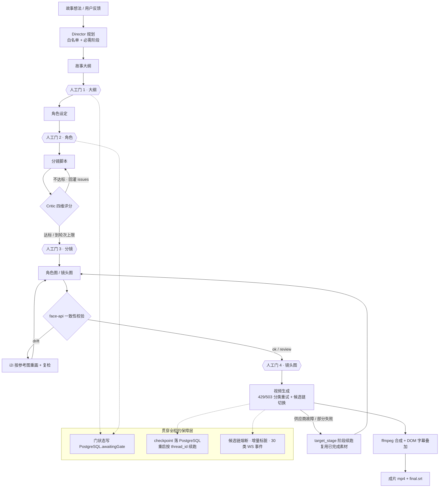

# MiraFrame 求职速查手册

> 简历写法 + 面试讲法 + 改造进度，三份合一。**数据截至 2026-11-28，基线 `31fa2c4` + 本轮未提交的契约/校验/瘦身修复（77 个提交）。**
> 用法：§1 抄简历 → §2 看懂流程 → §3 背讲法 → §4 速查问答 → §7 主动交代边界。
> 配套：[README.md](./README.md)（项目是什么）、[MODIFICATIONS.md](./MODIFICATIONS.md)（改动流水账）、[考前速记卡](./docs/INTERVIEW_CHEATSHEET.md)、[架构解读](./docs/architecture-walkthrough.md)、[演示脚本](./docs/DEMO_SCRIPT.md)。

---

## 1. 简历怎么写

### 三条红线

| 不要写 | 要写 |
| --- | --- |
| 独立从零设计开发 | **基于开源项目二次改造 / 主导 Agent 链路重构**（背调一查就穿帮） |
| 上线 / 生产环境 / 日活 / QPS | 学习、演示、原型；所有数字标注「本地演示环境」 |
| 纯前端 / 算法训练 / 自研多 Agent 框架 | 前端转 AI Agent，重心在 Agent 工程化与全栈落地 |

一句话原则：**只写「做了什么 + 用什么手段 + 得到什么可验证结果」**，故事和踩坑留到面试。

### 项目名片（可直接复制）

```text
MiraFrame 弥镜 | AI 漫剧生成 Agent 工作台 | 2026.09 – 2026.11
角色：核心开发（基于开源项目二次改造）
技术栈：TypeScript 5 / LangGraph.js / NestJS 11 / React 18 / PostgreSQL 16
       / Redis + BullMQ / Drizzle ORM / Socket.IO / Vitest / pnpm monorepo
简介：把「故事想法 → 大纲 → 角色 → 分镜 → 镜头图/视频 → 成片」拆成
     可解释、可中断恢复、可人工反馈、失败可自愈的多 Agent 流水线。
```

### 正文：标准版 4 条（推荐，AI 应用 / 全栈 / 后端岗）

1. **重构生成架构**：用 LangGraph.js 把固定流水线改成「workflow 骨架 + 模型决策节点」；Director 产出受白名单、必需阶段和默认顺序约束的执行计划，附 `planRationale` 便于回溯；Critic 以四维 rubric 做 LLM-as-Judge，不达标带 issues 回灌重写，有轮次上限和人工兜底；视觉 Critic 一次批量审 4 张关键帧（6 镜仅 2 次调用），按参考图重画结构性问题。
2. **落地可恢复的 HITL**：4 个 `interrupt` 人工门，等待位置落 PostgreSQL，前端经 WS 恢复按钮、Redis 消息唤醒图；`target_stage` 续跑配合镜头血缘标脏，只重跑受影响镜头，已完成素材不重生成。
3. **治理供应商失败**：文本 429 串行队列 + `Retry-After` + 指数退避，视频 503/队列满分类重试、封顶 120 秒；再上一层是候选链 + 熔断 + half-open 探测 + 只读健康端点。6 镜头项目原本只出 4 镜，续跑补齐。
4. **搭建一致性闭环**：face-api wasm 把 9 张图检测从 41 秒降到 1.8 秒（约 23×），距离阈值 0.45 / 0.6 + 贪心指派；漂移镜头自动按角色参考图 i2i 重画并复检，有开关、单轮预算和图像服务可用性闸门，人脸距离约 0.4 → 0.22。

**按岗位调整**：前端岗把「纸墨设计系统 + 30 类 WS 事件消费层 + 长任务可观察交互」提到前两条；Agent 岗把「Director / Critic + 工具层与 MCP + 滚动摘要」放前三；空间不够就用一行版——「基于 LangGraph.js 将固定流水线改造为 Director 规划 + Critic 打回 + 4 个人工门的可恢复多 Agent 系统，实现分类重试、阶段续跑与角色一致性闭环」。

### 可引用的数字（挑 3–4 个，不要全堆）

| 数字 | 口径 |
| --- | --- |
| 77 个提交 / 4 个包 / 227 个 TS·TSX 文件 / 46 个测试文件 | `git rev-list --count HEAD` 与源码统计 |
| 414 个测试（shared 26 / agent 96 / server 241 / frontend 51），build 与 typecheck 通过 | 各包 `__tests__/`，CI 保障 |
| 6 个生产阶段 / 4 个人工门 / 30 类 WS 事件 | `shared/src/constants/{stages,events}.ts` |
| 9 张图 41s → 1.8s（约 23×）；一致性端到端 1.85s（6 镜 / 3 角色） | `face.service.ts`；project-23 |
| 人脸距离约 0.4 → 0.22；临时项目实测 0.2562 / `ok` | i2i 反哺对照 |
| 6 镜成片约 34s，4 镜有 TTS 对白，另出 `final.srt` | 本地合成产物 |

> 对比型数字最有力，优先讲「41s → 1.8s」「0.4 → 0.22」。成片体积有 4.4MB / 5.17MB 两个历史口径，只写时长和镜头数。

### 措辞红线

| 别写 | 改成 |
| --- | --- |
| 参与 / 协助了后端开发 | 写明具体动作与结果（重构、落地、收敛、治理） |
| 实现了 AI 漫剧生成系统 | 把固定流水线改造成可解释、可恢复的多 Agent 系统 |
| 大幅提升性能 / 显著优化体验 | 41s → 1.8s、0.4 → 0.22 |
| 纯罗列 LangGraph / Redis / Zod | 关键词写进 bullet 上下文，不单列一行 |

---

## 2. 生成主流程（流程图）

实线是正常链路，虚线是贯穿全程的保障层。关键判断：**失败不从头重跑，而是从 `target_stage` 切入；一致性校验和自动修复都发生在生成视频之前。**



---

## 3. 怎么讲

### 30 秒版

> MiraFrame 是全 TypeScript 的 AI 漫剧生成工作台。我接手时是固定阶段流水线，改造后变成「workflow 骨架 + 模型决策节点」：Director 决定走哪些阶段，Critic 打分、不合格带意见打回，四个关键节点用 `interrupt` 做人工确认。外部模型限流、掉线、坏 JSON 都有降级路径。最后加了人脸一致性闭环：自动校验、漂移告警、按参考图 i2i 修正。全仓 pnpm monorepo，前后端共享阶段/事件契约（WS 事件名单一来源），启动期配置用 Zod 做校验。

### 3 分钟版（决策 → 执行 → 保障）

1. **决策层**：Director 产出 `executionPlan` 但受白名单与必需阶段约束；Critic 按四维 rubric 评分，不通过把 issues/suggestions 写回 `feedback`；ReviewAgent 决定用户反馈回流到哪个阶段。
2. **执行层**：LangGraph 串起 6 个生产节点和 4 个人工门；门位置落 `awaitingGate`，Redis 确认消息唤醒；续跑用 `target_stage` 切入，已完成素材不重生成。
3. **保障层**：429 串行队列 + Retry-After，503 分类重试封顶 120 秒；再上一层候选链 + 熔断应对密钥失效；一致性用 face-api wasm + 贪心指派，漂移自动 i2i 重画复检；前端经 30 类 WS 事件实时看到进度、门、产物和告警。

### 五个 STAR 案例（挑 2–3 个深讲）

**案例 1 · 让模型决定流程，但不让模型乱来**
- **问题**：固定流水线对 4 镜头短片也走满 6 阶段，既慢也无法解释。
- **做法**：Director 从模型回复抠 JSON；白名单过滤、去重、必需阶段补齐、按默认顺序重排；坏格式回退全链路，产出附 `planRationale`。
- **结果**：模型有裁量权但产出始终可控。
- **追问**：给了非法阶段怎么办？→ 过滤 + 补齐 + 重排，模型只裁剪可选阶段。

**案例 2 · LLM-as-Judge 不是打完分就结束**
- **问题**：早期 Critic 是硬编码 8.5 的桩，永远通过。
- **做法**：四维 rubric 真调用模型；阈值 `CRITIC_SCORE_THRESHOLD=6.0`、轮次上限 2；不通过时 `nextStage=plan_shots` 并把建议回灌下一轮；评审结果经 WS `critique_result` 推到前端评分卡片；模型异常降级人工审批。
- **结果**：生成 → 评估 → 带意见重写 → 再评估闭环，过程可见可回溯。
- **追问**：Judge 判错了？→ 轮次上限防拉扯，人工门兜底。

**案例 3 · 人工确认是可恢复的状态机，不是前端弹窗**
- **问题**：任务跑在后台 worker，刷新或重启后不知道该等谁确认。
- **做法**：4 个 `interrupt`；门名落 `agentRuns.awaitingGate`；前端靠 WS 恢复按钮，确认走 Redis；checkpoint 用 `PostgresSaver` 落库，`thread_id=thread-{projectId}-{runId}`；30 分钟超时取消。
- **结果**：刷新可恢复等待状态；补第 5、6 镜头只重跑渲染阶段。
- **追问**：checkpoint 存哪？→ PostgreSQL；只有单测才退回 `MemorySaver`。

**案例 4 · 真实供应商的失败恢复**
- **问题**：Kimi 429 且并发 1，Agnes 视频队列满返 503；密钥失效/欠费重试多少次都没用；早期误用付费模型烧了约 ¥17–27。
- **做法**：重试与选路分层——429 串行队列优先读 `Retry-After`，503/队列满分类重试封顶 120s；候选链 `TEXT_PROVIDERS=agnes,kimi`，连续失败 3 次熔断、指数冷却、half-open 探测；只切 401/403/429/5xx/网络错误，400/422 不切也不计熔断；血缘分析只标脏受影响镜头。
- **结果**：6 镜项目补齐缺失的 2 镜；本地双 server 验证了主 401 后切备、冷却到期探测恢复。
- **追问**：为什么不换付费模型？→ 成本不确定是原型最大风险，provider 已全量配置化；400 不切避免坏 prompt 打穿健康度。

**案例 5 · 一致性闭环：检测到反哺**
- **问题**：提示词写满「鹅蛋脸、低髻、木簪」也挡不住角色跨镜头长相漂移。
- **做法**：逐步三步——face-api wasm 提 128 维 descriptor（9 图 41s → 1.8s）；贪心指派 + 阈值 0.45/0.6 判定并把结果落库告警；`drift` 镜头按参考图走 i2i 重画并只复检这一张，挂 `generateShotFrames` 末尾，在生成视频前完成。
- **结果**：end-to-end 1.85s（6 镜 / 3 角色）；沈鸢距离约 0.4 → 0.22；只修 `drift`，`review` 不动。
- **追问**：为什么不用纯 LLM 判人脸？→ 需要可复现的数值门限做回归；LLM 管叙事和镜头语言，几何特征交给专用模型。

---

## 4. 高频问答速记（Q1–Q17）

| 题 | 一句话锚点 |
| --- | --- |
| Q1 为什么用 LangGraph | 节点、条件边、`interrupt` 显式化；`thread_id` + checkpoint 恢复；14 节点有结构测试 |
| Q2 让模型跳过阶段 | 白名单 + 4 个必需阶段 + 顺序重排 + 坏格式回退，模型只裁剪可选阶段 |
| Q3 HITL 怎么落地 | 4 个门；门名落 DB；WS 恢复按钮；Redis 消息恢复图 |
| Q4 断点恢复是真的吗 | 产物 / run / 门 / checkpoint 都在 PG；BullMQ 重拾 job；30 分钟残留清理 |
| Q5 限流怎么处理 | 重试扛抖动，候选链 + 熔断扛故障，配合 `target_stage` 续跑 |
| Q6 怎么评估质量 | face-api 数值门最硬 → 文本 Critic → 视觉模型最主观，三层各管一件事 |
| Q7 一致性不用纯 LLM | 0.45 / 0.6 距离阈值可复现可做回归；LLM 留给叙事 |
| Q8 前端出身写了什么 | 纸墨设计系统 + 工作台 + WS 消费层；后端 TTS / face-api / i2i；全栈 TS |
| Q9 和 EchoMind 的关系 | 六大考点迁移到内容生成场景；MCP 真实 server；记忆做滚动摘要 |
| Q10 最大技术债 | 已补 critique 事件 / ALS / provider 选路 / i2i；剩 SRT 外挂、单段摘要、进程内 WS 与熔断 |
| Q11 并发 8 不串号 | 只走 AsyncLocalStorage，取不到显式报错；删全局兜底；8 并发测试 |
| Q12 MCP 怎么接 | 先自实现 stdio 搞懂协议，再换官方 SDK；连接层与转换层分离；`isError` 语义坑；钉 1.0.1 |
| Q13 长会话记忆 | 增量滚动摘要，`coveredThroughId` 只前进；合并旧摘要；失败三条兜底 |
| Q14 provider 降级 | 重试 ≠ 选路；候选链 + 熔断；half-open 探测排最前；401/403 切，400/422 不切 |
| Q15 漂移自动修 | 三道闸：开关预算 / 图像服务非 fake 且有 key / 只修 drift；复检 `ok`、`review` 才算修好 |
| Q16 视觉 Critic | 4 图/次批量审；压缩内联；总分用分项均值；重画需「模型要求 + 低于阈值」双条件 |
| Q17 字幕为什么 DOM 叠加 | TTS 与字幕同源 `parseDialogue`；`timeupdate` 驱动；不改像素、可开关；成片另存 `final.srt` |

> Q14–Q17 的展开层次（旧痛点 → 设计 → 被测试逼出来的取舍 → 边界）见 [考前速记卡](./docs/INTERVIEW_CHEATSHEET.md)。

---

## 5. 对齐 Agent 六大考点

| 考点 | 对应实现 | 主动说的边界 |
| --- | --- | --- |
| 意图识别 | Director 把题材 + 反馈转成受约束的 `executionPlan`，带 `planRationale` | 是规划，没有独立意图分类器 |
| 工具调用 | `ToolRegistry` + `ToolLoop`，与 LangChain `tool()` 互通；MCP 官方 SDK + 自实现兜底 | 只有大纲节点挂了远端工具，MCP 是可选增强 |
| 多轮记忆 | 消息按轮注入 + 增量滚动摘要；checkpoint 落 PG | 单段摘要，没有向量检索、不跨项目复用 |
| 多 Agent 路由 | Director 规划 + Review 的 `FALLBACK_ROUTE` | 节点是类，不是独立进程 |
| Monitor 闭环 | 30 类 WS 事件 + `critique_result` 评分卡片 | 进程内广播，没接 Redis adapter |
| LLM-as-Judge | 文本 Critic + 视觉 Critic，均有阈值、预算、人工兜底 | 不审视频；视觉判定比数值阈值主观 |

> 不要六项都说成「完整实现」。挑 **多 Agent 路由 + LLM-as-Judge + Monitor 闭环** 讲扎实，其余坦诚说下一步补，反而可信。

---

## 6. 做完了什么 / 还剩什么

- **P0 已完成**：配置接口加 `ADMIN_TOKEN` 守卫、CORS 白名单、WS 房间校验；Critic 阈值统一为 `CRITIC_*`；删探针日志、宇宙页面残留、`db:push`；补最小 CI。
- **P1 已完成**：`PostgresSaver` checkpoint；`critique_result` 实时评分卡片；工具层 + MCP（官方 `@langchain/mcp-adapters@1.0.1`，自实现 stdio 兜底）；ALS 并发隔离；前端测试扩到 6 文件 / 51 用例。
- **P2 已完成**：增量滚动摘要；provider 候选链 + 熔断；漂移 i2i 自动联动；多模态 Critic；DOM 字幕上屏。
- **正确性修复（2026-11-28）**：历史消息改为取最近 120 条；补齐 review / 拒绝路由的目的地表；取消改为节点边界与逐镜检查的协作式抢占；大纲反馈改走 revision，不再污染 `story`；stage-only 消息不再把进度写回 0；参考图上传真正落盘；补图级 E2E。
- **契约收敛（2026-11-28）**：shared 从 UUID/Zod 旧模型改为真实接口契约（整数 ID、snake_case、ISO 时间）；前端只保留 UI 私有类型；服务端新增 DTO 层统一 REST 输出；WS 网关按 shared 事件表做类型约束；shared 补 Zod schema，在 REST 入参、DTO 出站、WS 出站三处运行时校验。
- **代码瘦身（2026-11-28）**：删除未接入图的 `RenderAgent`、恒为 false 的 `reviewRequested`；processor 拆出 agent-context / post-processing / gate / prompts，主文件 1206 → 424 行；删除未使用的 `agentmessage` 表并生成迁移；清理未使用构造依赖、导入、前端 `getStaticUrl` 与半废弃 typewriter 状态。
- **部署硬化（2026-11-28）**：可选 `API_TOKEN` 同时保护 HTTP/WS；`VITE_API_TOKEN` 构建期注入；单实例每分钟限流；compose 增加 `env_file` 与限流/Token 配置；命令类响应补 runtime schema。仍不是用户级鉴权。
- **收益递减的可选项**：`ProjectPage` 加载 / 错误态测试、真实浏览器 E2E、WS Redis adapter、按槽位或向量检索的记忆、按成本/延迟动态选路。
- **刻意不做**：ffmpeg 字幕烧录——DOM 叠加已解决上屏，烧录不可逆且需要额外字体 / libass 依赖。
- **部署阻塞**：ffmpeg/ffprobe、启动迁移、nginx `/static/`、`env_file`、可选 `API_TOKEN`（HTTP/WS）与单实例限流已补；仍缺用户级鉴权/会话、密钥托管、静态卷与可观测性。容器内无 `say`，默认关 TTS。当前**不公网部署**。

---

## 7. 诚实边界（主动交代比被问出来强）

- 项目是基于开源项目二次改造的学习 / 演示 / 原型，没有线上流量。
- 没有独立意图分类器；视频多模态 Critic 未做（图像已做，视频要抽帧）；选路是静态优先级 + 熔断，不是成本/延迟动态加权。
- 工具层只在大纲节点接入，MCP 只挂了素材库一个 server；熔断状态在进程内，多实例各算各的。
- 长期记忆是单段滚动摘要，没有向量检索、不跨项目复用；摘要失败时沿用旧摘要，不会清空。
- face-api 对半透明、背影、非人形参考图检不出脸，标 `no_reference`，不误判但也无法校验。
- 视觉 Critic 复用文本 provider 链只换 `VISION_MODEL`，纯文本模型会 400；只跑一轮不复审；重画后仍过人脸一致性检查。
- 字幕走 DOM 叠加，导出 mp4 不带字幕；后端另写 `final.srt`，但没有下载入口。
- 成本教训适合口述：早期误用付费模型产生约 ¥17–27，之后定下「探测只读、最小单任务、模型全配置化」规则。

---

## 8. 代码地图（按题目定位）

| 主题 | 文件 |
| --- | --- |
| 状态图与节点 | `packages/agent/src/graph.ts`、`nodes/index.ts`、`state.ts` |
| Director / Critic / Review | `packages/agent/src/agents/{director,critic,review}.ts`、`prompts/{director,critic}.ts` |
| 执行器与门持久化 | `packages/server/src/agent/agent.processor.ts`、`agent-run-state.ts` |
| 增量续跑与血缘 | `packages/server/src/agent/revision.service.ts`、`services/lineage.ts` |
| Provider 选路与失败恢复 | `packages/server/src/services/{provider-routing,text,video,image}.service.ts`、`modules/config/providers.controller.ts` |
| 一致性闭环 | `packages/server/src/services/{face,consistency,shot-repair,auto-repair}.service.ts`、`agent/agent.processor.ts` |
| 工具层与 MCP | `packages/agent/src/tools/*`、`tools/mcp/servers/assets-server.mjs` |
| 滚动摘要与 checkpoint | `packages/agent/src/conversation-memory.ts`、`checkpointer.ts` |
| 前后端契约 | `packages/shared/src/types/*`、`constants/{events,stages,approval}.ts` |
| 台词解析与字幕 | `packages/shared/src/utils/dialogue.ts`、`packages/frontend/src/components/project/SubtitleOverlay.tsx` |
| 前端工作台 | `packages/frontend/src/pages/ProjectPage.tsx`、`components/project/*`、`hooks/useWebSocket.ts` |

---

## 9. 上场前自检

- 随便指一条简历 bullet，能否在 90 秒内讲清「什么问题 → 为什么这么选 → 怎么验证 → 局限在哪」？讲不清就删。
- 数字不超过 4 个，且每个都能说出本地演示环境的口径。
- 准备好 2–3 个 STAR 案例和一段 30 秒总纲；演示视频与截图放在 [docs/DEMO_SCRIPT.md](./docs/DEMO_SCRIPT.md)。
- 主动交代 §7 的边界，不要等面试官挖。
- 讲「Agent」时落在决策、评估、恢复、记忆这些可验证的机制上，不要只报技术栈名字。
