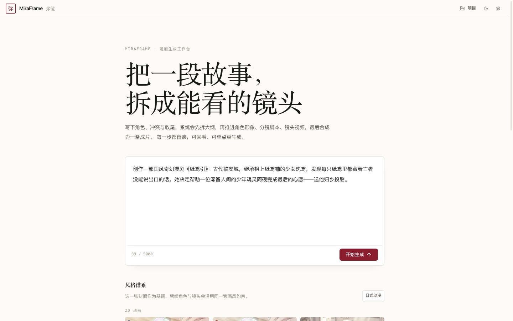
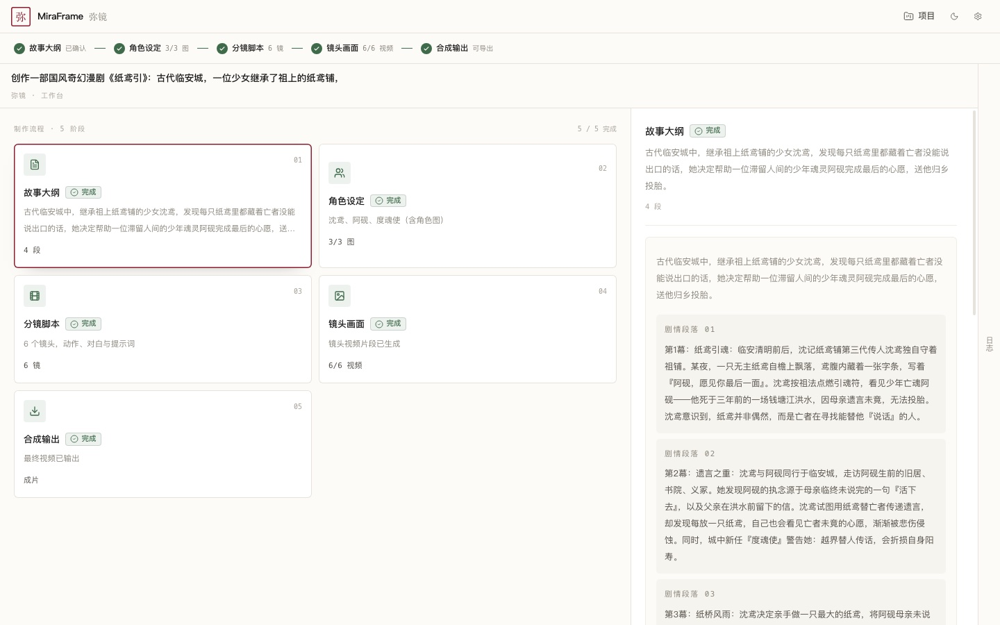

# MiraFrame 弥镜

> 基于 GitHub 开源项目二次改造的**学习 / 演示 / 原型项目**。具体改了什么见 [MODIFICATIONS.md](./MODIFICATIONS.md)。


**用大白话说**：给它一句故事想法，它按「大纲 → 角色 → 分镜 → 角色图 → 镜头画面 → 视频 → 成片」一步步做出来。每一步都能看到进度、停下来让人确认或修改；某一步调用失败，也不会把前面做好的成果全部重来。

---

## 1. 先说清楚：它是什么，不是什么

| 它是什么 | 它不是什么 |
| --- | --- |
| 学习 AI Agent 工程化的完整例子：状态图、人工确认、断点恢复、失败降级都真实存在 | 不是开箱即用的商业产品，也没有公网部署 |
| 本地能跑起来的全栈原型：有页面、数据库、队列、WebSocket 实时进度 | 不是模型训练项目，没有自己训模型 |
| 可以接真实文本 / 图像 / 视频模型；也可以切 `fake` 模式，不花 API 钱跑通流程 | `fake` 模式只会给占位图，不要拿它判断生成质量 |
| 前端转 AI Agent 方向的面试素材：全仓库 TypeScript，前后端共享类型 | 不是「一句 prompt 出片」的玩具 Demo |

---

## 2. 本地跑起来

### 准备

- Node.js >= 22
- pnpm >= 9
- Docker Desktop（或者本地已有 PostgreSQL + Redis）

启用 pnpm：

```bash
corepack enable
corepack prepare pnpm@9.12.0 --activate
```

### 四步启动

```bash
# 1. 只启动数据库和 Redis
docker compose -f docker-compose.dev.yml up -d

# 2. 准备环境变量（默认 fake provider，不需要 API Key）
cp .env.example .env

# 3. 安装依赖
pnpm install

# 4. 分别开两个终端，启动后端和前端
pnpm --dir packages/server dev
pnpm --dir packages/frontend dev
```

然后打开：

- 前端：<http://localhost:5173>
- 后端 API：<http://localhost:3000>

### 想看真实生成效果

可以在页面右上角「设置」里填 Key，或者改 `.env` 后**重启后端**：

```env
TEXT_PROVIDER=openai
TEXT_BASE_URL=https://dashscope.aliyuncs.com/compatible-mode/v1
TEXT_API_KEY=你的_key
TEXT_MODEL=模型名
```

一家供应商挂了想自动换下一家，用候选链（按顺序试，连续失败就熔断并切备用）：

```env
TEXT_PROVIDERS=agnes,kimi
TEXT_KIMI_BASE_URL=https://api.moonshot.cn/v1
TEXT_KIMI_API_KEY=你的_key
TEXT_KIMI_MODEL=kimi-k3
```

不写 `*_PROVIDERS` 时行为和单供应商完全一样。可用 `GET /api/v1/providers` 查看各家的健康状态（不含密钥）。完整变量说明见 [.env.example](./.env.example)。

---

## 3. 先看效果，再决定要不要跑

一段 19 秒无旁白的[工作流巡览视频](./docs/demo.mp4)：从首页输入故事，跳到工作台，依次点开五个节点，最后停在成片画面。






**诚实说明**：视频里首页填字后展示的是同一个已完成项目，没有真的提交生成（避免消耗额度）；素材来自真实项目 23《纸鸢引》。一致性漂移红点、评分卡展开、字幕开关这三处需要正在进行中的项目另录，完整两分钟讲解词和分镜表见 [docs/DEMO_SCRIPT.md](./docs/DEMO_SCRIPT.md)。

---

## 4. 主要功能（人话版）

| 功能 | 解决什么问题 |
| --- | --- |
| 多阶段生成工作流 | 把「想法 → 成片」拆开，每步有自己的状态和产物，不用一次请求硬等 |
| 人工确认与反馈 | 大纲、角色、分镜阶段会停下来等人确认，也能输入意见重做这一段 |
| 失败恢复 | 限流、故障、坏 JSON 都有降级路径；已完成素材可复用，按阶段续跑 |
| 角色一致性闭环 | 镜头图出来自动做人脸比对；漂移镜头按角色参考图重画并复检，有开关和单轮预算 |
| 关键帧视觉审查 | 视觉模型逐张看画面，按画风 / 质量 / 构图 / 一致性打分，检出问题可重画 |
| 逐句字幕 | 播放器上盖一层 DOM 字幕，随播放进度切换，可开关；导出 mp4 保持干净画面 |
| 供应商选路与熔断 | 同一家内重试扛抖动，跨供应商候选链扛故障（密钥失效、欠费等） |
| 实时进度 | 后端通过 WebSocket 推送节点状态、日志、产物和告警 |

---

## 5. 代码怎么放

```text
MiraFrame/
├── packages/
│   ├── frontend/   # React 18 + Vite + Zustand + TanStack Query
│   ├── server/     # NestJS API + WebSocket + Drizzle + BullMQ
│   ├── agent/      # LangGraph.js 状态图与 Agent 节点
│   └── shared/     # 共享类型、Zod Schema、阶段名、WS 事件
├── docs/           # 演示视频、截图、专题文档
├── docker-compose.yml / docker-compose.dev.yml
└── .env.example
```

依赖方向很简单：`frontend → server → agent`，三者都依赖 `shared`。

- `shared` 只放契约，前后端共用一套类型和校验规则。
- `agent` 只管决策，不认识数据库和 HTTP。
- `server` 负责「脏活」：数据库、队列、供应商调用、消息推送。
- `frontend` 只通过 REST 和 WebSocket 跟后端说话。

逐文件、逐字段走一遍完整请求链路，见 [docs/architecture-walkthrough.md](./docs/architecture-walkthrough.md)。

---

## 6. 文档地图：按目的找

| 你想做的事 | 看哪份 |
| --- | --- |
| 第一次了解项目、本地跑起来 | 就是本文 |
| 写简历、准备面试、看改造进度 | [CAREER_HANDBOOK.md](./CAREER_HANDBOOK.md)：简历模板 + 讲法 + 五个 STAR + 17 问答 + 完成度；[考前速记卡](./docs/INTERVIEW_CHEATSHEET.md)：两页纸 |
| 想知道改了什么、为什么改 | [MODIFICATIONS.md](./MODIFICATIONS.md)：改造流水账 |
| 想跟着代码走一次生成 | [docs/architecture-walkthrough.md](./docs/architecture-walkthrough.md) |
| 要录演示 / 补截图 | [docs/DEMO_SCRIPT.md](./docs/DEMO_SCRIPT.md) |
| 看最初的改造方案（历史材料，多数已实现） | [docs/multi-agent-upgrade-plan.md](./docs/multi-agent-upgrade-plan.md) |

---

## 7. 常见问题

**没有 API Key 能跑吗？**
可以。`.env` 里三个 provider 都设成 `fake` 就能跑通基础流程，但只适合看交互，不适合看生成质量。

**为什么页面提示「生成服务还没有完全配置」？**
文本 / 图像 / 视频里至少一项还是 `fake`，或者真实 provider 缺 `BASE_URL`、`API_KEY`、`MODEL`。去右上角设置面板补上即可。

**改了 `.env` 为什么没生效？**
部分配置到不了已启动的进程，改完请重启后端开发服务。

**导出的 mp4 为什么没有字幕？**
字幕是盖在 `<video>` 上的 DOM，不写进视频像素——改台词不用重新编码整条片子。合成时后端另存了 `final.srt`（`static/exports/project-<id>/final.srt`），要带字幕交付就和 mp4 一起导入剪辑软件。

**数据库名从 openOii 改成 MiraFrame，会丢数据吗？**
默认库名现在是 `miraframe`。不要随意改 Docker Compose 的 project name 或 volume 名，否则可能挂到新卷、旧数据看起来「消失」。

**能直接部署上线吗？**
暂时不能。Docker 文件只是骨架，公网部署前还缺 ffmpeg / ffprobe、`say` 语音、自动迁移、若干环境变量与静态卷配置。当前定位是本地学习、演示和原型。

---

## 8. 常用命令

```bash
pnpm test         # 全仓测试
pnpm typecheck    # 类型检查
pnpm build        # 构建所有包
pnpm lint         # 代码检查
pnpm test:watch   # 监听模式跑测试

# 数据库迁移
pnpm --dir packages/server db:generate
pnpm --dir packages/server db:migrate
```

**当前基线**（截至 2026-11-25，commit `c49fb69`，72 个提交）：443 个测试通过（shared 79 / agent 92 / server 221 / frontend 51），`pnpm build` 与 `pnpm typecheck` 通过。

---

## License

MIT
