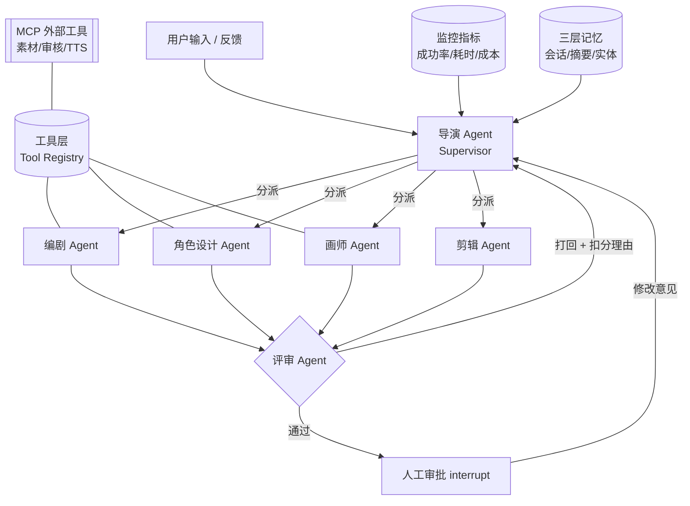

# MiraFrame 多 Agent 升级改造计划

> 版本：v0.3（范围裁定稿）
> 目标：把 MiraFrame 从「固定阶段的生成流水线」升级为「workflow 骨架 + agent 决策节点」的混合架构，具备多 Agent 协作、自主路由、记忆管理、MCP 工具接入、质量闭环与可观测性。
> 适用范围：`packages/agent`、`packages/server/src/agent`、`packages/shared`

---

## 0. 范围裁定（v0.3）

工期单位一律改为「晚上」（按每天 2-3 小时计）。原来的完整计划（v0.2）保留在本文档后部作为参考蓝图，但**执行只按下面的分层来**：

| 层级 | 内容 | 工期 |
| --- | --- | --- |
| **核心（必须做完）** | P0 地基（缩水版）+ P1 真实 Critic + P2 Supervisor | 约 14-17 个晚上 |
| **强烈建议（高性价比）** | P5 对抗 hack（P1 的副产品）+ P2.5 轻量版（L1 会话 + L2 摘要，砍 L3 实体表） | 约 5-7 个晚上 |
| **可选（有余力再做）** | P3 裁剪版（只做并行 + 增量重生成，砍智能路由） | 约 4-5 个晚上 |
| **押后（找到实习再说）** | P3 智能路由、P4 一致性、P4.5 MCP 完整版 | — |

**已确认的执行决策**（2026-10-28）：投递窗口 1 个月，每天 3 小时以上。按 90 小时总预算执行：**P0 → P1 → P5 hack → P2** 为主干（约 50-60 小时），P2.5 轻量版作为窗口内富余时的候补。P2 是难点且风险最高，务必在投递前完成「计划生成可演示 + 动态门刷新可恢复」这两条验收，哪怕裁掉计划可视化。

裁定理由：

- P0+P1+P2 就是「多 Agent」叙事的完整骨架：工具层 + 真实质量闭环 + Supervisor 决策，做完简历上完全立得住。
- P5 对抗本质是「两个 prompt + 一次仲裁」，裁判复用 P1 的 Critic rubric，2-3 个晚上能 hack 出来，和 P2 一起讲就是完整的多 Agent 故事。
- MCP 面试热词但 agent 含量低，且依赖前面所有阶段稳定；因 Tool Registry 直接对齐 LangChain `tool()` 协议（见 P0），将来接 `mcp-adapters` 只需半天，押后无沉没成本。
- **危险红线**：不允许出现「旧流水线拆了一半、新架构没成型」的半迁移状态。每个阶段结束旧全链路（generate → 4 门 → 成片）必须仍然绿。

---

## 1. 现状诊断

### 1.1 已经具备的地基

| 能力 | 现状 | 位置 |
| --- | --- | --- |
| 状态图编排 | `StateGraph` + 条件边 + `interrupt` 审批 | `agent/src/graph.ts` |
| 节点即 Agent 的雏形 | `BaseAgent` 抽象，5 个 Agent 类 | `agent/src/agents/*.ts` |
| 人工介入 | 4 个 approval 节点 + `review` 回流 | `graph.ts`、`agents/review.ts` |
| 状态契约 | `critiqueScores`、`critiqueRound`、`artifactLineage`、`routeMode` | `agent/src/state.ts` |
| 阶段定义 | 16 个 stage 的单一数据源 | `shared/src/constants/stages.ts` |
| 执行链路 | BullMQ 队列 + Nest 处理器 + WS 推送 | `server/src/agent/agent.processor.ts` |

### 1.2 关键差距

| 差距 | 具体表现 |
| --- | --- |
| **Critic 是桩** | `CriticAgent` 里 `score = 8.5 / 8.0` 硬编码，永远通过阈值，质量闭环等于不存在 |
| **无工具层** | `AgentContext` 全是硬编码方法（`saveOutline`、`createShot`…），Agent 没有可发现、可选用的工具集 |
| **无调度者** | 流程顺序写死在 `graph.ts`，没有 Supervisor 决定「这题材要不要跳阶段 / 要不要加一轮」 |
| **Agent 之间无通信** | 只有 state 共享，没有消息传递、没有 handoff、没有「打回重做」的语义 |
| **`artifactLineage` 空转** | 字段存在但没被用来做影响面分析，增量重生成仍是整段重跑 |
| **无路由策略** | provider 失败只能整体重试，没有成本/延迟/成功率驱动的选路与降级 |
| **上下文失忆** | `TextService.generate(prompt)` 只拼 `[system, user]`，`callLlm(systemPrompt, userPrompt)` 单轮签名；`messages` 表有数据但无人消费，用户反馈跨轮不连贯 |
| **无法接外部能力** | 无 MCP，任何外部服务（素材库、审核、TTS）都只能写死在 `ImageService` 这类硬编码服务里 |
| **上下文注入靠模块级变量** | `_nodeCtx` 全局单例 + mock 兜底，并发执行会串号 |

> 结论：这不是「从零做多 Agent」，而是「给已有骨架补上决策权、工具层和质量反馈」。改造量可控，但每一步都要有可验证的产出。

---

## 2. 目标架构



四条设计原则：

1. **流程骨架不推翻**：主链路仍是显式状态图，保证可恢复、可回滚、可人工审批。
2. **决策点交给模型**：路径选择、是否重做、用哪个 provider、要不要调工具，由 LLM 决策。
3. **Agent 边界 = 职责 + 工具 + 独立上下文**：不是一个 prompt 就是一个 Agent。
4. **每个阶段可独立验收**：任何一步停下来，项目都应该是能跑、能演示的。

---

## 3. 分阶段计划

依赖关系（箭头 = 必须先完成；括号内为 v0.3 裁定层级）：

```text
P0 地基[核心] ──> P1 真实 Critic[核心] ──> P2 Supervisor[核心]
                      │                        │
                      └──> P5 对抗 hack[建议]   └──> P2.5 轻量记忆[建议]
P2 完成 ──> P3 并行/增量[可选，砍智能路由] ──> P4 一致性[押后] ──> P4.5 MCP[押后]
```

- P2 与 P2.5 轻量版可并行推进。
- P5 hack 只在 P1 上线后才有意义（对抗需要可信的裁判）。
- 押后项的详细设计保留在本文档，作为「找到实习后继续」的蓝图——面试里讲「我知道后面该做什么」也是加分项。

### Phase 0 — 地基：工具层与上下文治理（核心，约 2-3 个晚上）

**目标**：让 Agent 能「用工具」，并消除全局上下文隐患。

| 事项 | 交付物 |
| --- | --- |
| Tool Registry（不自研格式） | 直接用 LangChain `tool()` 协议做薄封装：`registry.ts` 只负责授权与过滤（哪些 Agent 能看见哪些工具）。理由：P4.5 的 mcp-adapters 输出的就是 LangChain tool，对齐生态标准，零迁移成本 |
| 上下文改造（缩水版） | processor 已有 `runWithNodeContext`（AsyncLocalStorage），并发路径本身是安全的；实际工作 = 删掉 `_nodeCtx` 兜底 + mock 静默降级改抛错 + 写一个双项目并发测试。一晚搞定 |
| 产物结构化 | 每个节点产物写入 `artifacts`（type/version/parentIds），补齐 `artifactLineage` 的实际写入 |
| 结构化输出 | 引入 Zod schema + 解析重试，替代「让模型返回 JSON 然后 `JSON.parse`」 |

**验收**：任一 Agent 通过工具协议取到数据；两个项目并发执行时上下文不串；**旧全链路（generate → 4 门 → 成片）验证脚本仍然绿**。

---

### Phase 1 — 让质量闭环真的跑起来（核心，3-4 个晚上，收益最直观）

**前置条件（硬性）**：接入一个真实 API key（便宜模型即可，如 deepseek/qwen-flash）。fake provider 下 Critic 打不了真分、多候选演示不了，本阶段所有验收在 fake 模式下都是空的。

**目标**：把 `CriticAgent` 的假分数换成真打分，形成「打分 → 不达标 → 带理由重生成」的闭环。

| 事项 | 交付物 |
| --- | --- |
| 评分 rubric | 分阶段定义维度：大纲（叙事连贯性 / 角色弧光 / 节奏 / 钩子）、角色（一致性 / 辨识度 / 与设定吻合）、分镜（画面可执行性 / 镜头语言 / 信息完整） |
| 真实打分 | 调 LLM 输出结构化 `{dimension: score, reason}`，加权汇总，写入 `critiqueScores` |
| 阈值与轮次 | 接现有 `CRITIQUE_ENABLED / CRITIQUE_SCORE_THRESHOLD / CRITIQUE_MAX_ROUNDS`，不再硬编码 7.0/2 |
| 反馈注入 | 不达标时把「扣分维度 + 具体理由」写进 state，作为下一轮生成的约束输入 |
| 多候选 | 关键节点支持 `candidates: 2-3` 并行生成，Critic 选优（或融合） |

**验收**：故意提交一个逻辑崩坏的大纲，Critic 给出 < 阈值分数并触发重生成；评分理由能在前端节点详情里看到；**旧全链路验证脚本仍然绿**。

---

### Phase 2 — 引入 Supervisor：从「按图执行」到「自主规划」（核心，8-10 个晚上，本计划真正的难点）

**目标**：把 `graph.ts` 的固定顺序，改为 Supervisor 输出执行计划后动态执行。

**设计约束（本阶段最大的坑，先立规矩再写码）**：

- `awaiting_gate` 持久化恢复 + `agentForGate` + `buildInitialApprovalHistory` 预设 + approve-outline「新起 run」逻辑，全部建立在**门的序列固定**这个前提上。Supervisor 一旦动态化，这套机制会被击穿。
- 因此约束为：**Supervisor 只能「选择 / 跳过 / 重排预定义的门」，不能发明新门**。门的集合不变（4 个审批点 + review），动态的只是哪些门被执行。这样恢复机制可以继续按 stage 查表，只是查表结果可能为空（被跳过）。

| 事项 | 交付物 |
| --- | --- |
| 计划结构 | `Plan = { steps: Step[], rationale: string }`，Step 含 `agent`、`inputs`、`dependsOn` |
| 导演 Agent | `agents/director.ts`：读项目输入 → 生成计划 → 按计划 handoff；支持「短篇跳过角色图阶段」这类动态裁剪 |
| 消息层 | state 增加 `messages: AgentMessage[]`（role/from/to/type/payload），取代纯字段共享 |
| 条件路由下放 | 重试决策改为：Critic 给建议 → Director 决定重试 / 换策略 / 上报人工（降级到便宜 provider 属于押后的路由范畴，此处不实现） |
| 计划可视化 | 前端展示 Supervisor 的 plan 与 rationale（复用现有 `sendThinking`） |

**验收**：① 同一段故事输入，切换「短篇 / 系列剧」两个模式，执行计划不同且都能跑通；② **刷新页面后，动态计划产生的门照常恢复**（approve 按钮不丢）；③ Supervisor 的决策理由在 UI 可见；④ **旧全链路验证脚本仍然绿**。

---

### Phase 2.5 — 多轮上下文与记忆管理（轻量版：3-4 个晚上；完整版押后）

**执行裁定**：只做 L1（会话窗口）+ L2（滚动摘要），砍掉 L3 实体记忆表——L3 的角色圣经本来就在押后的 P4 里有更完整的归宿，此处不重复建设。验收也相应降级。

**为什么值得保留轻量版**：`TextService.generate(prompt, options)` 只拼 `[system, user]` 两条消息，`AgentContext.callLlm(systemPrompt, userPrompt)` 也是单轮签名——**每次重生成都是失忆的**。`messages` 表已有 `agent / role / content / summary` 字段但无人消费，做轻量版是把现成数据用起来，投入很小。

轻量版范围：

- `callLlm` 改消息数组签名，旧单轮调用保留为语法糖。
- L1：每次生成前读最近 N 轮消息原文注入。
- L2：轮次 > 8 或 token 超阈值时滚动压缩，压缩 prompt 强制保留「决策、否定项、未解决问题」。
- 反馈意图分类（简化版二分类：需要重新生成 / 只需对话回复），接 `RevisionService.targetStageFor()`。

（完整版的三层记忆、token 预算装配器、负面记忆、幂等设计——见文末附录，找到实习后可按蓝图继续。）

**验收（轻量版）**：连续三轮反馈被正确分类（两条触发重生成、一条仅回复）；第二轮反馈能正确呼应第一轮内容。

---

### Phase 3 — 并行与增量重生成（可选/裁剪版：4-5 个晚上；智能路由押后）

**执行裁定**：只做并行 + 增量重生成（工程含金量最高的两件事）；智能路由与指标管道押后——它们是锦上添花的管道活，且 provider 元数据建设成本不低。

| 事项 | 交付物 |
| --- | --- |
| 并行渲染 | 分镜图/视频按 shot 拆成子任务，`Promise.all` 限流执行；单镜失败只重跑该镜 |
| 增量重生成 | 基于 `artifactLineage` 做影响面分析：改动角色 A → 只标脏引用 A 的分镜与画面，其余复用缓存 |

**验收**：修改一个角色设定后，只有受影响的镜头重新生成；**旧全链路验证脚本仍然绿**。

（智能路由、指标采集、预算护栏的完整设计见文末附录 v0.2 蓝图，押后。）

---

### Phase 4 — 一致性与反馈沉淀（押后）

**目标**：解决 AI 漫剧最痛的角色/画风漂移，并把用户反馈变成可复用的资产（记忆的读写在 P2.5，这里解决「怎么用得准」）。角色圣经是本阶段核心，P2.5 轻量版砍掉的 L3 实体记忆在来这里补全。

| 事项 | 交付物 |
| --- | --- |
| 角色圣经 | 结构化档案（外貌、服装、配色、口癖、画风 token），作为强制注入块 |
| 参考图链路 | 出图时把角色定妆图作为 reference 传入（provider 能力声明是否支持） |
| 检索工具 | `character.search`、`style.search`：查询改写 + LLM 重排，供分镜/画师 Agent 自主调用 |
| 反馈沉淀 | 用户修改前后 diff 落库，作为评测样本与 few-shot 来源 |

**验收**：同一角色跨 5 个镜头出图，人工盲测辨识度明显高于改造前。

---

### Phase 4.5 — MCP 工具化（押后；因 P0 对齐了 LangChain tool 协议，重启成本约半天）

这件事有两个方向，建议都做，但顺序不能反。

**方向 A：做 MCP Client（先做）——让 MiraFrame 能接外部能力**

- 引入 `@langchain/mcp-adapters`，把外部 MCP server 的工具自动转成 LangChain tool，注册进 Phase 0 建好的 Tool Registry。
- 典型用途：素材 / 参考图库检索、风格参考库、外部审核服务、TTS 与音效服务。
- 收益：不用为每个外部服务写一遍胶水代码，Tool Registry 成为唯一接入点。

**方向 B：做 MCP Server（后做）——让 MiraFrame 的能力被外部调用**

- 把 `plan_outline`、`plan_shots`、`render_shot_images` 暴露成工具，任何支持 MCP 的客户端（Claude Desktop、IDE、其他 Agent）都能驱动漫剧生成。
- 这也是「流水线即平台」的叙事，但必须等内部工具层稳定后做，否则等于把不稳定接口固化出去。

工程约束：

| 项 | 决策 |
| --- | --- |
| 传输 | 开发期 stdio；生产 streamable HTTP（SSE 已过时，不建议） |
| 工具粒度 | 一个 stage 一个工具，不做细粒度拆分，避免工具爆炸导致模型选错 |
| 契约 | 每个工具 Zod schema + 幂等键 + 明确的错误码 |
| 权限 | 读类（查询）直接放行；写类（出图 / 出片）需显式 scope + 预算上限 + 人工确认 |
| 安全 | 外部 server 白名单机制，禁止任意 URL 动态安装；统一超时与并发限制 |
| 观测 | 每次调用记录 `mcp_call`（server / tool / latency / error），进 Phase 3 的指标管道 |
| 与 Supervisor 的关系 | Supervisor 可见工具 = 内置 Agent 工具 + MCP 工具，由权限表过滤后注入 |

**验收**：从外部 MCP 客户端成功触发一次「生成大纲」；内置 Agent 能自主调用一个外部 MCP 检索工具并把结果用于分镜生成。

---

### Phase 5 — 多 Agent 对抗（强烈建议，2-3 个晚上 hack，排在 P1 之后）

**执行裁定**：原计划按 1 周排是虚胖。它的本质是「两个不同 persona 的编剧 prompt 并行 + 一次 Critic 仲裁」，裁判直接复用 P1 的 rubric，是 P1 的副产品而非独立工程。见缝插针做，别单独立项。

**目标**：用「对抗 + 仲裁」换质量上限，作为面试叙事的加分项。

- 两个编剧 Agent（不同 persona / 不同模型）并行出大纲
- 评审 Agent 仲裁：指出各自优劣，输出融合版
- 只在「大纲」和「关键分镜」两个高价值节点启用，其余节点不拆（成本原因）

**验收**：A/B 对比单 Agent 与对抗版本，评审打分中位数提升，且成本增幅可接受（有数据）。

---

## 4. 代码结构改动（预期）

```text
packages/agent/src/
├── state.ts                  # 新增 messages / artifacts / plan / metrics
├── graph.ts                  # 增加 supervisor 入口，条件边改为按 plan 路由
├── agents/
│   ├── base.ts               # 增加 tools 声明、callTool、handoff
│   ├── director.ts           # 新增：Supervisor
│   ├── critic.ts             # 重写：真实四维打分
│   ├── outline.ts / plan.ts / render.ts / compose.ts
│   └── review.ts             # 保留规则引擎，作为 Director 的一个工具
├── tools/
│   ├── registry.ts           # LangChain tool() 薄封装：注册 + 授权过滤
│   └── character.ts / style.ts
├── routing/                  # [押后] 路由与指标管道
├── context/                  # [轻量版只做 intent.ts + 简化 compressor]
├── memory/
│   ├── session-store.ts      # messages 读写
│   └── feedback-store.ts
├── mcp/                      # [押后] client.ts / server.ts / permissions.ts
└── prompts/                  # 各 Agent 独立 prompt + rubric 定义
```

`packages/shared` 需同步：`AgentMessage`、`ToolDescriptor`、`CritiqueRubric`、`ProviderMeta`、`MemoryRecord`、`McpToolDescriptor` 的 Zod schema，保证前后端与 Agent 共用一套契约。

新增依赖：`@langchain/mcp-adapters`、`@modelcontextprotocol/sdk`（服务端暴露能力时使用）。

---

## 5. 风险与不做的事

| 风险 | 应对 |
| --- | --- |
| 多 Agent 导致 token 成本翻倍 | 只在高价值节点拆分；草稿走便宜模型；设置预算护栏 |
| 延迟变长 | 并行化抵消；Supervisor 不做多轮自我反思，避免无限循环 |
| 调试困难 | 每条 Agent 消息与决策理由落库 + WS 推送，前端可回放 |
| 状态膨胀 | `messages` 做摘要压缩，只保留最近 N 条原文 |
| **上下文超窗 / 摘要失真** | 预算装配 + 分层压缩；决策与否定项永不被压缩丢弃；每次装配记录 token 快照便于回溯 |
| **记忆污染** | 反馈幂等键；压缩摘要带版本号；负面记忆需显式确认后才生效 |
| **MCP 安全与延迟放大** | server 白名单、写操作 scope + 预算上限、统一超时；MCP 工具默认不参与 Supervisor 首轮规划，避免拖慢决策 |
| 过度拆分 | 明确「不做的」：不给每个阶段配独立大模型、不做无上限 autonomous loop、不做自建 Agent 框架 |

---

## 6. 里程碑与演示脚本（v0.3 执行版）

| 里程碑 | 内容 | 可演示的东西 | 累计工期（晚上） |
| --- | --- | --- | --- |
| M1（P0） | 工具层 + 上下文治理 | 并发两个项目不串号；Agent 调工具取数据 | 2-3 |
| M2（P1） | 真实 Critic | 坏大纲被打回，理由上屏 | 5-7 |
| M2.5（P5 hack） | 双编剧对抗 | 两版大纲同屏对比 + 仲裁理由 | 7-10 |
| M3（P2） | Supervisor | 同一输入两种模式计划不同；刷新后门照常恢复 | 15-20 |
| M3.5（P2.5 轻量） | 会话窗口 + 滚动摘要 | 三轮反馈被正确分类；第二轮呼应第一轮 | 18-24 |
| M4（P3 裁剪，可选） | 并行 + 增量 | 改一个角色只重跑 3 个镜头 | 22-29 |

**核心 Demo 主线**（M3 完成即可演示，4 分钟）：输入故事 → Supervisor 出计划（短篇模式跳过角色图）→ 编剧出 2 版大纲 → Critic 打分打回一版 → 重生成通过 → 人工审批 → 导出成片。

**加分 Demo**（视进度追加）：多轮否定式反馈正确分类；双编剧对抗对比；只重跑受影响镜头。

**每阶段硬性回归项**：旧全链路（generate → 4 门 → 成片）验证脚本保持绿。

---

## 7. 面试叙事映射

| 常考考点 | 本项目落点 |
| --- | --- |
| 多 Agent 编排 | Supervisor + 专职 Agent + handoff 消息协议（核心） |
| 意图/路由 | 计划生成、反馈意图分类、重试策略（核心）；provider 选路与降级（蓝图） |
| 工具调用 | 基于 LangChain `tool()` 协议的注册与授权（核心，对齐生态标准） |
| MCP | Client/Server 双向设计完整（蓝图），核心期以协议对齐为伏笔 |
| 记忆管理 | 会话窗口 + 滚动摘要 + 反馈分类（核心）；三层完整版见蓝图 |
| 质量评估 | 分阶段 rubric + LLM-as-Judge + 多候选仲裁 + 对抗融合（核心） |
| 可观测性 | 决策理由与消息可回放（核心）；指标管道（蓝图） |
| 工程化 | 可恢复状态图、动态门恢复、人工审批、增量重生成（核心/可选） |

一句话定位（可直接背）：

> 「这是一个 workflow 为骨架、agent 为决策节点的混合架构。创作主流程用显式图保证可控与可恢复，路径规划、质量判定和重试策略交给模型决策——生产级 Agent 系统本来就该这么设计。」

---

## 8. 待定问题

1. Supervisor 用单次规划（plan-once）还是每步重规划（replan）？倾向 plan-once + 失败重规划，控制成本。
2. Critic 是否复用主生成模型？建议独立小模型 + 强 rubric，避免自评自夸偏差。
3. 记忆压缩用「固定轮次」还是「语义边界」触发？倾向轮次 + token 双阈值，语义边界靠压缩 prompt 约束。
4. 负面记忆是否允许用户手动查看与删除？建议允许，否则用户会觉得「系统记仇」。
5. MCP Server 暴露的工具是否需要独立的鉴权体系（API Key / OAuth）？对外发布前必须解决。
6. 是否把外部 MCP 工具纳入 Supervisor 首轮规划？倾向不纳入，改为执行中按需发现（避免规划延迟与工具过多导致选择困难）。

---

## 附录：押后项完整设计（v0.2 蓝图摘录，供「找到实习后」续建）

### A1. 三层记忆完整版（P2.5 完整版）

| 层 | 内容 | 存储 |
| --- | --- | --- |
| L1 会话窗口 | 最近 N 轮原文，含审批通过 / 打回决定 | `messages` 表（已有） |
| L2 项目记忆 | 滚动摘要：已定风格、已否决方向、关键设定 | `messages.summary` + 新增 `project_memory` 表 |
| L3 实体记忆 | 角色圣经、风格约束、负面清单（negative memory） | 结构化表 + 工具检索 |

- 上下文装配器：`context/assembler.ts`，输入 `(agent, stage, task)` → 分节 prompt，按 token 预算分配（system 10% / 实体记忆 20% / 会话 50% / 任务 20%），超预算降级为摘要。
- 压缩触发：轮次 > 8 或 token > 预算 70%；压缩必须保留「决策、否定项、未解决问题」。
- 负面记忆：用户明确否决的内容单独存、生成时作为禁止项注入；幂等键防重试污染。

**验收（完整版）**：五轮否定式反馈（含「回到第二版但保留结尾」的回指），第三次生成正确理解指代；token 稳定在预算内。

### A2. 智能路由与指标管道（P3 押后部分）

- `routing/router.ts`：按 `stage`（草稿/定稿）、成本预算、provider 健康度选路；失败自动降级到备用 provider。
- 指标采集：每节点记录 `{duration, tokens, cost, provider, success}`；滑动窗口统计成功率，驱动路由权重。
- 预算护栏：单项目 token/费用上限，超限转人工确认。
- Provider 元数据：text/image/video 每个 provider 增加 `{cost, latencyP95, successRate, capabilities}`。

**验收**：杀掉主力 provider 后流程自动降级完成，不中断。
